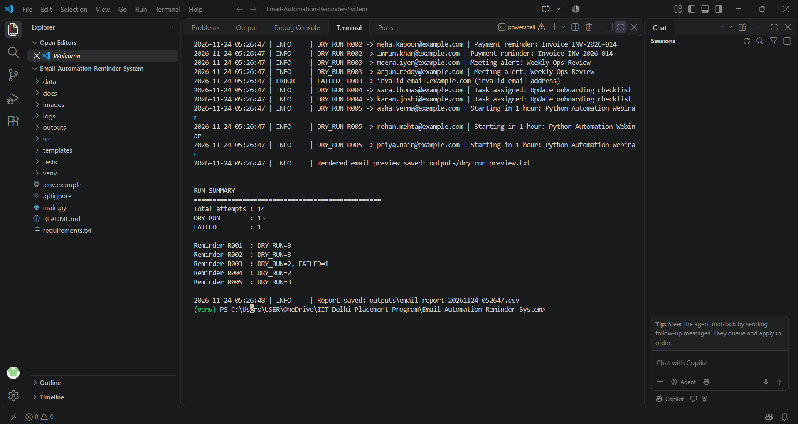
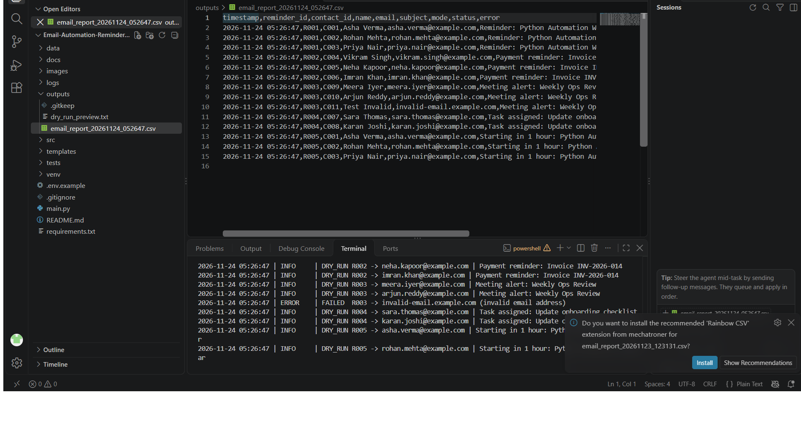
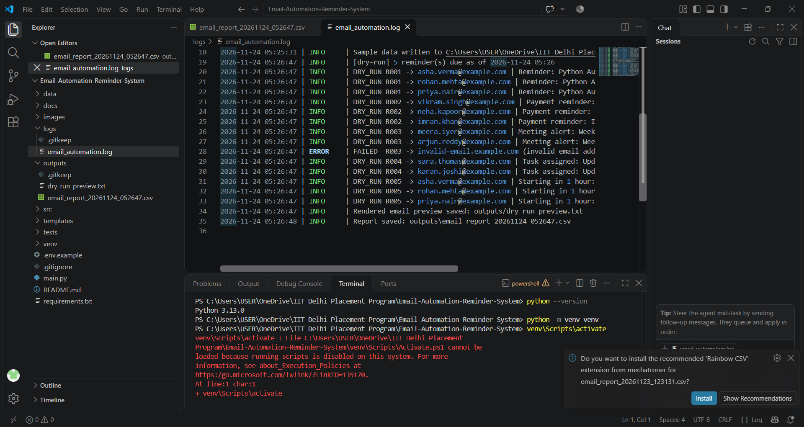
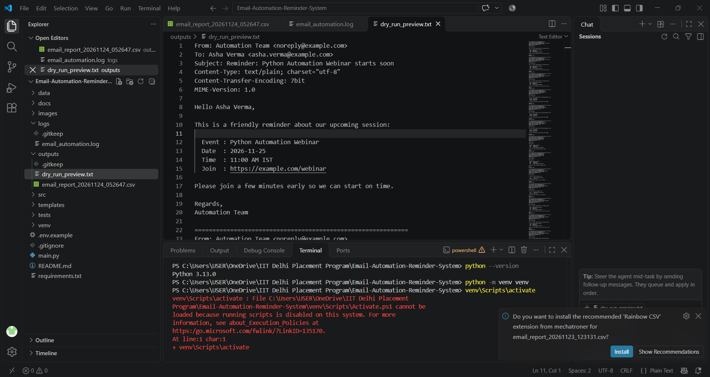
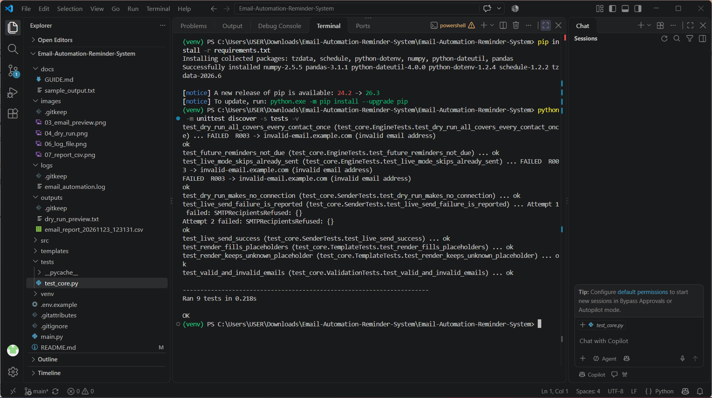

# Email Automation & Reminder System

A beginner-friendly Python project that automates reminder emails (webinar, payment, meeting and task reminders) from CSV contact lists and message templates, with scheduling, safe dry-run testing, logging and CSV reports.

> **Safe by default:** the program never sends a real email unless you explicitly pass `--send`. All sample data uses `example.com` addresses.

## Problem Statement

Teams in HR, sales, operations and training send the same kinds of emails over and over: "your webinar starts tomorrow", "invoice due on Friday", "meeting at 10 AM". Doing this by hand is slow, error-prone, and easy to forget. This project automates the whole cycle and records what happened.

## Industry Relevance

| Team | Typical use |
|------|-------------|
| Trainers / Education | Webinar and class reminders, assignment deadlines |
| Sales | Follow-ups, payment reminders |
| HR | Onboarding tasks, policy acknowledgements, interview schedules |
| Operations / Admin | Meeting alerts, task notifications, shift reminders |

## Features

- Reads contacts and reminders from CSV files (pandas)
- Personalized emails from text templates (`{name}`, `{event_date}`, ...)
- Group targeting (`Students`, `Sales`, `HR`, `Operations`, or `All`)
- Time-based scheduling: only reminders that are due are sent
- `--schedule` mode that keeps checking on a timer (uses `schedule` if installed)
- **Dry-run mode** (default): full workflow, zero real emails
- SMTP sending (Gmail-compatible, STARTTLS/SSL) with retry on failure
- Duplicate protection: the same reminder is never sent twice to the same person in live mode
- Email address validation; bad addresses are logged as failures, not crashes
- Log file + timestamped CSV report for every run
- Passwords kept in environment variables (`.env`, git-ignored)
- Unit tests (SMTP is mocked, so tests never email anyone)

## Tech Stack

Python 3.9+, pandas, smtplib, email.message, schedule (optional), python-dotenv (optional), logging, unittest.

## Folder Structure

```
Email-Automation-Reminder-System/
├── data/            contacts.csv, reminders.csv (dummy data)
├── templates/       message templates (.txt)
├── src/             application modules
│   ├── config.py          paths + environment settings
│   ├── data_loader.py     read/validate CSVs
│   ├── template_engine.py fill {placeholders}
│   ├── email_builder.py   build EmailMessage
│   ├── email_sender.py    SMTP send / dry-run / retries
│   ├── engine.py          core workflow
│   ├── scheduler.py       timer loop
│   ├── report.py          CSV report + summary
│   ├── logger_setup.py    logging config
│   └── sample_data.py     dummy data generator
├── tests/           unit tests
├── outputs/         reports and email previews
├── logs/            email_automation.log
├── images/          screenshots
├── docs/            full guide, sample output
├── .env.example     template for secrets
├── requirements.txt
├── .gitignore
└── main.py          command-line entry point
```

## Setup

```bash
# 1. Clone
git clone https://github.com/emilsarasebastian/Email-Automation-Reminder-System.git
cd Email-Automation-Reminder-System

# 2. Virtual environment
python -m venv venv
venv\Scripts\activate          # Windows
source venv/bin/activate       # Mac / Linux

# 3. Install
pip install -r requirements.txt
```

## Environment Variables (only needed for live sending)

```bash
cp .env.example .env     # Windows: copy .env.example .env
```

Edit `.env`:

```
SMTP_HOST=smtp.gmail.com
SMTP_PORT=587
SENDER_EMAIL=your_email@gmail.com
SENDER_PASSWORD=your_16_char_app_password
SENDER_NAME=Automation Team
```

For Gmail, turn on 2-Step Verification and create an **App Password**; do not use your normal password. Never commit `.env`.

## How to Run

```bash
python main.py --generate-sample          # fresh dummy data dated around today
python main.py                            # dry-run: only reminders that are due now
python main.py --all                      # dry-run: every reminder, ignoring dates
python main.py --as-of "2026-11-25 10:30" # simulate a different date/time
python main.py --schedule --interval 5    # keep running, check every 5 minutes
python main.py --send                     # LIVE: real emails (asks for confirmation)
python -m unittest discover -s tests -v   # run tests
```

### Sample Output

```
[dry-run] 5 reminder(s) due as of 2026-11-23 12:30
DRY_RUN R001 -> asha.verma@example.com | Reminder: Python Automation Webinar starts soon
DRY_RUN R002 -> vikram.singh@example.com | Payment reminder: Invoice INV-2026-014
ERROR   FAILED  R003 -> invalid-email.example.com (invalid email address)
...
==================================================
RUN SUMMARY
==================================================
Total attempts : 14
DRY_RUN        : 13
FAILED         : 1
```

Generated files: `logs/email_automation.log`, `outputs/email_report_<timestamp>.csv`, `outputs/dry_run_preview.txt`.

## Screenshots
### Dry-run output


### CSV report


### Log file


### Personalized email preview


### Tests passing



## Learning Outcomes

- Reading and validating CSV data with pandas
- Building emails with `email.message` and sending via `smtplib` (STARTTLS)
- Managing secrets with environment variables
- Structuring a Python project into small, testable modules
- Scheduling recurring jobs
- Logging, error handling, retries and idempotency (no duplicate sends)
- Writing unit tests with mocks

## Possible Improvements

HTML emails, attachments, Streamlit dashboard, SQLite instead of CSV, unsubscribe list, timezone support.

## License

MIT (add a LICENSE file if you want to publish under it).
